<div align="center">

# JomiCheck — Check Before You Buy Land

**Enter a mouza, dag number and seller's name — or snap the seller's papers. Get a lawyer-grade risk report, with the law behind every finding, in under a minute.**

[Live App](https://jomicheck.abdnoman.com) · [Demo Video](#) · [Sample Papers](frontend/public/samples)

_LandTech Innovation Hackathon 2026 · Digital Land Records, Verification & Digitization · Problem P5 (Citizen Pre-Purchase Verification) with P3 (Fraud & Double-Selling Detection)_

     

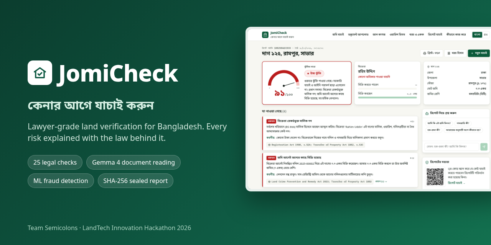

</div>

## Problem Statement

In Bangladesh, buying land is the largest purchase most families ever make — and one of the riskiest. The facts that decide whether a sale is safe are scattered across offices: the **khatian** from four surveys (CS, SA, RS, BS), **mutation** cases at the AC Land office, **deeds** at the sub-registry, court cases, **khas** and **acquisition** lists, bank **mortgages**, **powers of attorney** and the **land tax** record.

What buyers actually do today:

- They **trust the seller's word** and the papers the seller hands over — because they cannot read and cross-check all of these records themselves.
- They pay a **deed writer or broker** who often has an interest in the sale going through.
- They pay the **bainanama advance first** and discover problems only after the money is gone.
- Lawyers who do proper due diligence are **expensive and far away**, especially for rural buyers and migrant workers buying from abroad.

That gap is exactly where land fraud happens:

| Risk | What happens to the buyer |
|---|---|
| Seller is not the owner | Land recorded in someone else's name, or a deceased owner's land sold without the other heirs |
| Double selling | The same dag was already sold by deed, or promised by bainanama to someone else |
| Over-selling by heirs | An heir sells more than his Faraiz share; siblings and the widow later sue |
| Forged papers | A fabricated khatian, a deed number that does not exist, a tax receipt for taxes never paid |
| Restricted land | Khas, vested, waqf or forest land; acquisition notices; injunctions; mortgages |

The result: lost life savings, years in civil court, and broken families. **JomiCheck lets a citizen screen a plot before paying a single taka — in Bangla, without being a lawyer.**

## Solution Overview

JomiCheck is a web application (works in any phone browser, no install) that checks a plot the way an experienced land lawyer would and returns a transparent **Low / Medium / High** risk report:

| Output | What you get |
|---|---|
| **Risk Score** | 0–100 with LOW / MEDIUM / HIGH — every point comes from a named rule, never a black box |
| **25 Legal Checks** | Ownership, double selling, mutation, khas/vested land, acquisition, litigation, injunction, mortgage, bainanama, power of attorney, minor's share, pre-emption, survey lineage, fraud patterns |
| **Law on Every Finding** | The Act and section, a plain-language explanation, what to do, and a question to ask the seller |
| **Faraiz Shares** | Each heir's share under Muslim law ('awl, radd, Umariyyatan) and detection of heirs selling more than their share |
| **Forged Paper Check** | Upload khatian, deed and dakhila photos — Gemma reads them, code compares every field with the record |
| **ML Fraud Signal** | An Isolation Forest flags unusual transfer patterns — quick flips, brokers reselling — that no single rule catches |
| **Khatian & Lineage** | Latest record of rights in the official layout, plus the CS → SA → RS → BS → mutation chain |
| **Mouza Map** | The buyer's dag highlighted, neighbouring dags coloured by risk |
| **Sealed Report** | SHA-256 hash + QR code — a bank or family member scans it to confirm the report was not edited |
| **Ask the Report** | Questions in Bangla or English, answered only from the report's facts |
| **Plot Watch** | Alerts for any new deed, case, mortgage or buyer interest until registration |
| **Purchase Cost** | Stamp duty, registration fee, local tax, source tax and mutation fees, plus a land unit converter |
| **Print / PDF** | A clean printable report for the family, bank or lawyer |

The whole interface is available in **বাংলা and English**.

This is **not a chatbot that guesses legal answers**. The core value is a deterministic _records → 25 legal rules → explainable score_ engine. AI only reads papers and explains results; it never decides whether land is safe.

## How Gemma Is Used

Gemma reads what humans hand over — photos of khatians, deeds and tax receipts — and explains the report in plain language.

- **Model:** `gemma-4-26b-a4b-it` — Gemma 4 vision, Mixture-of-Experts with **~4B active parameters**: fast enough to read a khatian in about 10 seconds, capable enough for Bangla land documents. Swappable via the `LLM_MODEL` env var.
- **Access:** Google AI Studio through the official `google-genai` SDK. Any OpenAI-compatible server (e.g. self-hosted Gemma on Ollama) works by changing `LLM_API_URL` — so citizen documents can later stay on government servers.

**Design decisions that make it trustworthy:**

1. **Image part placed _before_ the text prompt**, with **JSON output** — each paper comes back as structured fields: document type, mouza, JL, khatian, dag, owners and shares, deed number, parties, date, area, tax year.
2. **Code parses Bangla, not the model** — Bangla numerals, ana-gonda-kora-kranti shares and shotok/katha/acre units are converted by tested Python, so a misread digit can't silently change a share.
3. **The forgery decision is made by code, not AI.** `documents/crosscheck.py` checks whether the khatian number exists in that mouza, whether owners and shares match, whether the deed number is in the sub-registry record or was cancelled, and whether the tax receipt's paid-up year matches. A contradiction raises a **Critical** finding under the Land Crime Prevention and Remedy Act 2023 (s.5) and Penal Code (ss.467, 471).
4. **The user stays in control** — extracted fields are shown in an editable form before verification runs.
5. **Grounded assistant** — "Ask about this report" receives only the computed report, answers in the user's language, and the UI labels which source answered. With no API key, a built-in bilingual legal glossary answers instead.
6. **Built for real networks** — minimal thinking for speed, automatic retry with backoff on 503/429, and a hard cap on total wait time. Uploaded files are processed in memory and never stored.

**Machine learning layer.** An Isolation Forest (scikit-learn) scores every sale of the plot in the last ten years plus the proposed sale on five features: price ÷ mouza rate, holding period, sales of the dag within a year, share of the dag sold, and dags sold by the same seller within a year. Trained on 20,000 synthetic transfers with 5% planted fraud, it reaches **precision 0.745, recall 0.712, F1 0.728, false-positive rate 0.013** on a separate synthetic test set of 5,000. It never declares land unsafe on its own — it adds evidence to a rule or raises one Major finding with plain-language reasons.

## Technical Architecture

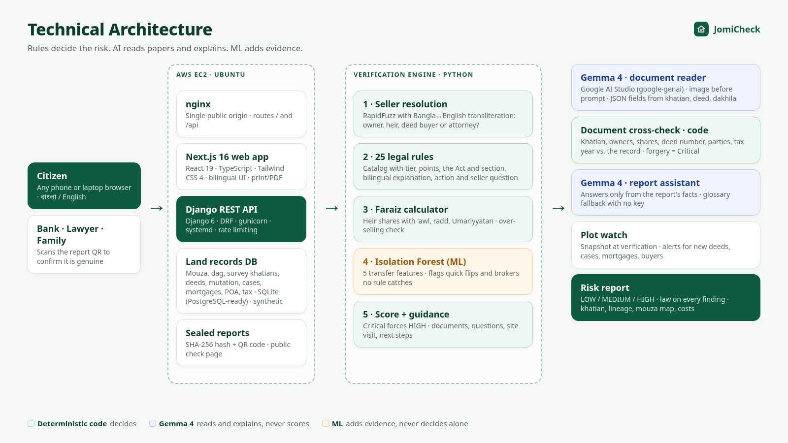

**Risk scoring:** **Critical** findings (seller not the owner, double selling, khas land, acquisition, injunction, invalid POA, forged paper) add 35–40 points and force **HIGH**. **Major** findings (litigation, survey break, over-selling, minor's land, mortgage, rapid transfers, missing mutation, prior bainanama, ML signal) add 20–30. **Minor** findings (pre-emption, wrong khatian, under-priced deed, tax arrears, other buyers checking) add 5–10. LOW 0–30 · MEDIUM 31–60 · HIGH 61–100.

**Stack summary:** Next.js 16 + React 19 + TypeScript + Tailwind CSS 4 (frontend) · Django 6 + Django REST Framework, Python 3.12+ (backend) · Gemma 4 via Google AI Studio (document reading, assistant) · scikit-learn + RapidFuzz (ML, name matching) · SHA-256 + QR (integrity) · SQLite, PostgreSQL-ready · AWS EC2 with nginx, gunicorn, systemd and Let's Encrypt HTTPS, installed by one script.

## User Flow

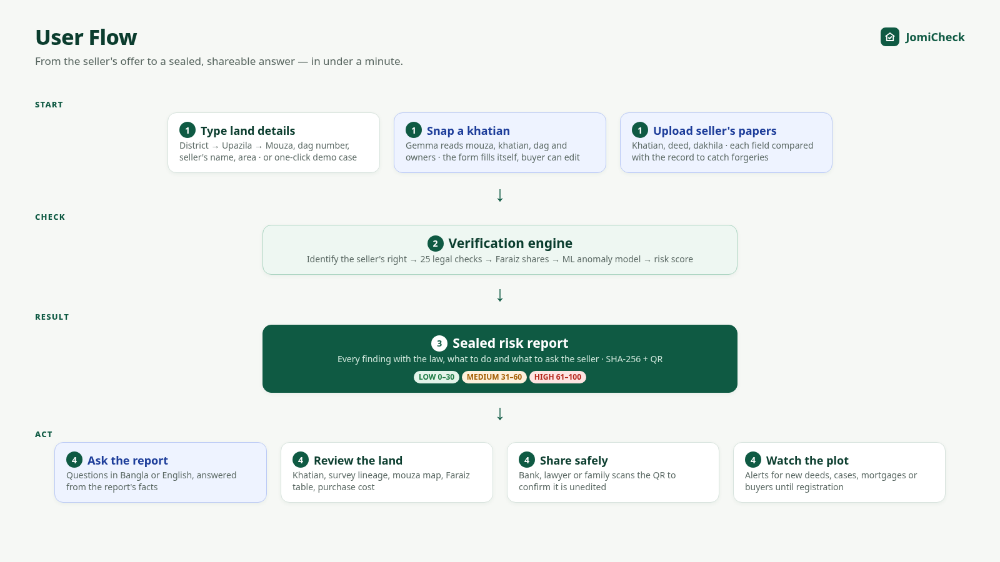

## Screenshots

| **Verify Land** | **High Risk: Seller Not the Owner** |
|---|---|
| 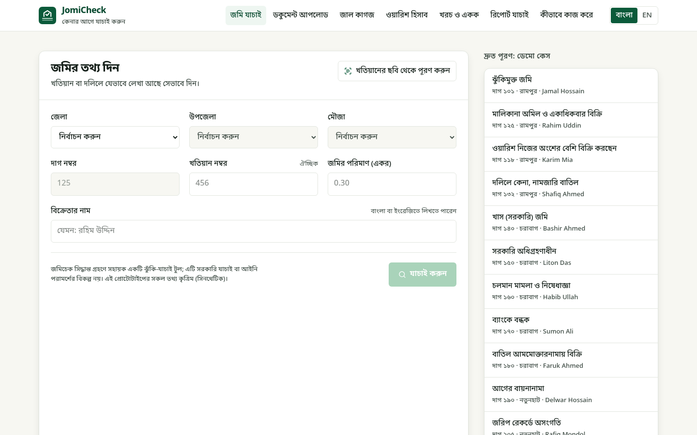 | 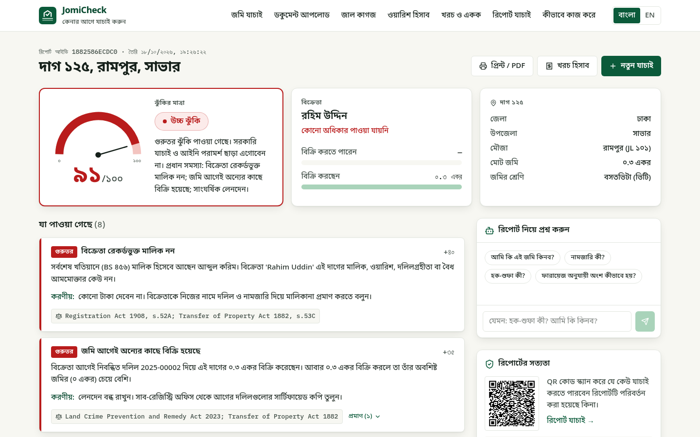 |
| **Heir Over-Selling Faraiz Share** | **Only the ML Model Catches This Broker** |
| 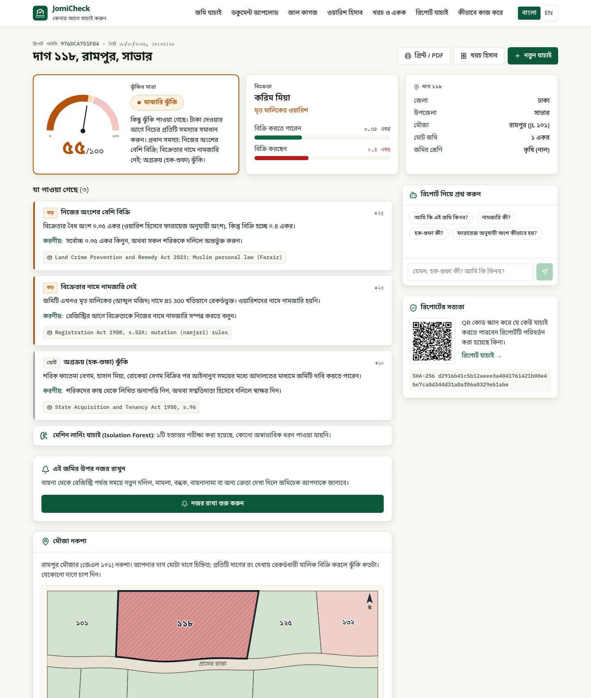 | 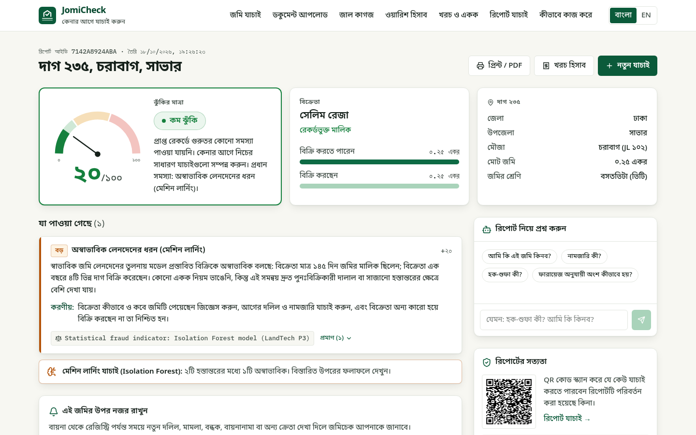 |
| **Latest Khatian (Official Record)** | **Forged Khatian Handed Over (Sample)** |
| 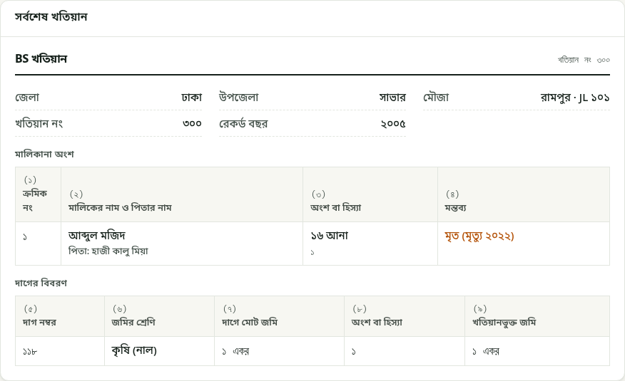 | 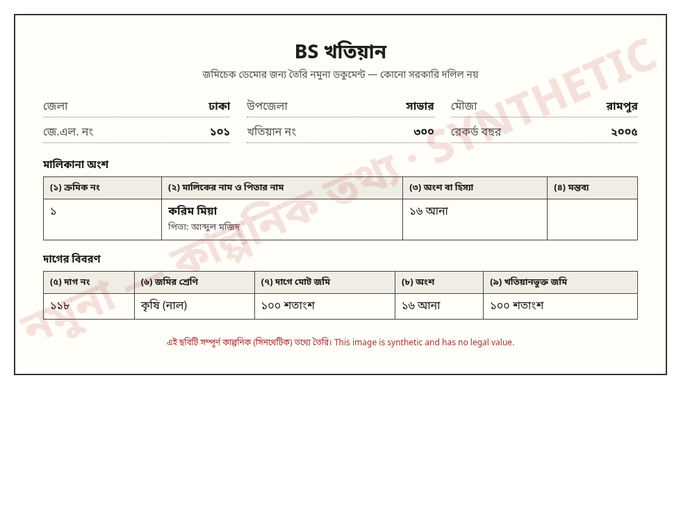 |
| **Mouza Map** | **Faraiz Shares** |
| 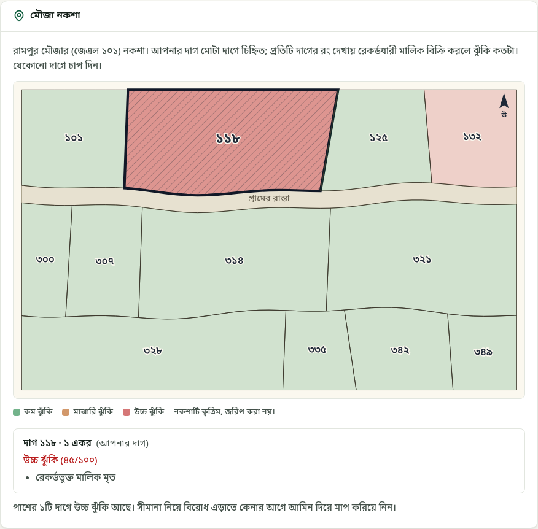 | 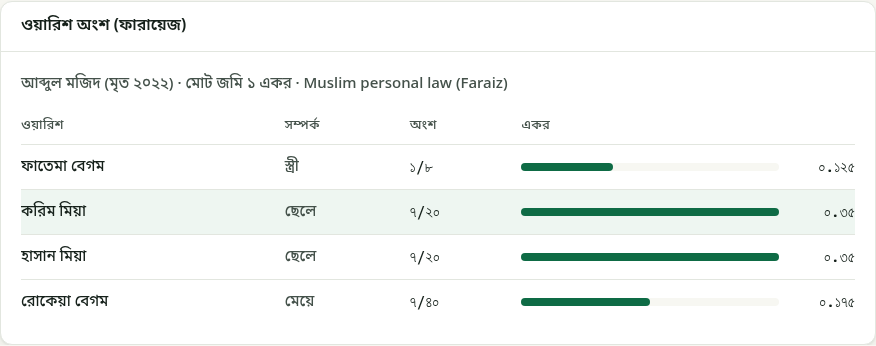 |
| **QR Check: Report Is Genuine** | **Purchase Cost** |
| 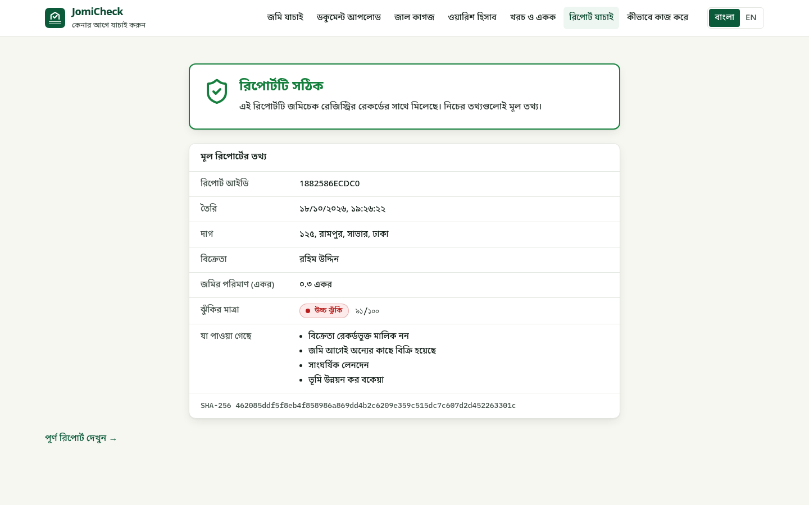 | 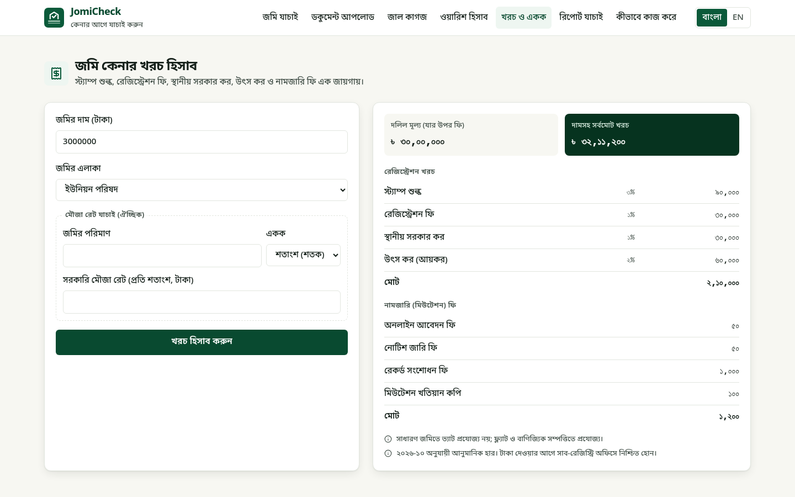 |

The forged khatian names Karim Mia sole owner of dag 118 with 16 ana. The record shows the land is still in his late father Abdul Majid's name with four heirs — JomiCheck raises a Critical finding.

## Impact & Validation

- **Prevents loss before it happens:** the check runs before the bainanama advance changes hands — the only moment fraud is still fully preventable.
- **Explainable by design:** every point in the score traces to a named rule and its law, so a buyer, lawyer or bank officer can follow — and challenge — the reasoning.
- **Tested on 14 planted fraud scenarios:** from a clean sale (LOW 6) to double selling (HIGH 91), khas land, injunction, revoked power of attorney, a widow selling a minor's share, and a broker pattern that only the ML model catches. All 14 are covered by automated tests.
- **76 automated tests:** Faraiz, every demo scenario, khatian notation, costs, ML model, AI document reading and assistant (mocked), forged-paper cross-check, plot watch, mouza map, API and tamper detection.
- **Tamper-evident sharing:** a bank, lawyer or family member abroad scans the QR to confirm the report is the original.
- **Accessibility:** full Bangla interface and plain-language explanations; works on a low-cost phone over a mobile connection because the heavy work runs on the server.
- **Who benefits:** first-time and rural buyers, migrant workers, banks and NGOs lending against land, lawyers and deed writers, and the courts through fewer land disputes.
- **Path to real use:** the engine already uses the national record structure (mouza, JL, dag, survey khatians, mutation case, deed). Connecting authorised e-Porcha, e-Mutation, land tax and sub-registry APIs replaces the synthetic database without changing the rules.

## Run It Yourself

### Prerequisite

Python 3.12+ and Node.js 20+. Optional: a free Gemma API key from [Google AI Studio](https://aistudio.google.com/apikey) for document reading and the AI assistant — everything else works without it.

### Option A — Local development

```bash
# 1. Backend
cd backend
python3 -m venv ../.venv && source ../.venv/bin/activate
pip install -r requirements.txt
cp .env.example .env                  # optional: paste your key into LLM_API_KEY
python manage.py migrate
python manage.py seed_demo            # load the synthetic dataset
python manage.py runserver 8000

# 2. Frontend (new terminal)
cd frontend
cp .env.example .env.local            # NEXT_PUBLIC_API_URL=http://localhost:8000/api
npm install && npm run dev            # open http://localhost:3000
```

### Option B — Deploy on AWS EC2 (one command)

```bash
# copy the project to /opt/jomicheck on an Ubuntu server, add LLM_* to backend/.env, then:
cd /opt/jomicheck && bash deploy/setup.sh <public-ip-or-domain> [email]
```

Installs Python, Node and nginx, generates a secret key, migrates and seeds an empty database, trains the ML model, builds the frontend and starts everything under systemd. With a domain and an email it also gets a free Let's Encrypt certificate and redirects HTTP to HTTPS. Open ports 80 and 443 in the security group, and attach an Elastic IP so the address never changes.

### Option C — Useful commands

```bash
python manage.py check_llm --list                            # Gemma models your key can use
python manage.py train_anomaly                               # retrain the ML model
python manage.py make_sample_docs                            # regenerate sample khatians, deeds, dakhilas
python manage.py simulate_watch_event 101 --kind injunction  # demo a plot-watch alert
python manage.py test                                        # run the 71 backend tests
```

Try it immediately with the one-click demo cases on `/verify`:

| Scenario | Dag / Mouza | Seller | Result |
|---|---|---|---|
| Clean property | 101 Rampur | Jamal Hossain | LOW 6 |
| Ownership mismatch + double selling | 125 Rampur | Rahim Uddin | HIGH 91 |
| Heir selling more than Faraiz share | 118 Rampur | Karim Mia | MEDIUM 55 |
| Bought by deed, mutation rejected | 132 Rampur | Shafiq Ahmed | MEDIUM 34 |
| Khas land | 140 Charabag | Bashir Ahmed | HIGH 80 |
| Government acquisition | 150 Charabag | Liton Das | HIGH 40 |
| Suit with injunction | 160 Charabag | Habib Ullah | HIGH 70 |
| Bank mortgage | 170 Charabag | Sumon Ali | MEDIUM 31 |
| Revoked power of attorney | 180 Charabag | Faruk Ahmed | HIGH 35 |
| Prior bainanama by co-owner | 190 Notunhat | Delwar Hossain | MEDIUM 36 |
| Break in survey records | 205 Notunhat | Rafiq Mondol | MEDIUM 36 |
| Rapid low-price transfers | 215 Notunhat | Imran Hossain | MEDIUM 33 |
| Widow selling minor heir's land | 225 Shantipur | Nasima Begum | HIGH 80 |
| Broker reselling quickly (only ML catches it) | 235 Charabag | Selim Reza | LOW 20 + ML flag |

For forged papers, open `/check-documents` and pick a sample set: a forged khatian for dag 118, or a forged deed and tax receipt for dag 125.

## API Reference

| Endpoint | Method | Purpose |
|---|---|---|
| `/api/locations/` | GET | District → Upazila → Mouza tree |
| `/api/mouzas/<id>/plots/` | GET | Dag numbers in a mouza |
| `/api/mouzas/<id>/map/` | GET | Mouza map with each dag's record risk |
| `/api/demo-cases/` | GET | The 14 demo scenarios |
| `/api/verify/` | POST | Run verification and store a sealed report |
| `/api/inheritance/` | POST | Standalone Faraiz calculator |
| `/api/documents/extract/` | POST | Read a khatian, deed or tax receipt image/PDF with Gemma |
| `/api/documents/check/` | POST | Compare read documents with the records |
| `/api/watch/` | GET, POST | List watched plots with alerts / start watching |
| `/api/watch/<id>/` | DELETE | Stop watching |
| `/api/costs/estimate/` | POST | Purchase cost estimate |
| `/api/reports/<id>/` | GET | Report with QR code |
| `/api/reports/<id>/verify/?h=<sha256>` | GET | Authenticity check |
| `/api/reports/<id>/ask/` | POST | Ask the report assistant |

## Limitations & Future Work

**Current limitations**

- **All land data is synthetic.** Every person, plot, khatian, deed, case and NID is fictional. No government portal is accessed or scraped.
- **Locations cover all of Bangladesh:** all 64 districts and 495 upazilas, with their 4,800+ unions and pourashavas listed as mouzas (names from the MIT-licensed [bangladesh-geo-json](https://github.com/iqbalhasandev/bangladesh-geo-json)). No open dataset lists all ~56,000 mouzas with JL numbers, so JL numbers here are serial. Land records exist only in the four ★ demo mouzas.
- JomiCheck is **decision support, not legal advice** — every report says so and directs the buyer to the AC Land office, sub-registry and a lawyer.
- ML accuracy is measured on **synthetic transfers**; it must be retrained on real, authorised data. Under-valued deeds alone are hard for the model (recall 0.11), which is why a separate price rule handles them.
- Mouza map outlines are **generated, not surveyed**.
- Automatic inheritance covers **Muslim law only**; for other owners JomiCheck asks for a lawyer's review instead of guessing.
- Purchase-cost rates were compiled from public information in October 2026 and are indicative.

**Future work**

- **Connect authorised government APIs** — e-Porcha, e-Mutation, land development tax and sub-registry deed records — in place of the synthetic database.
- **Self-hosted Gemma** on government servers so citizen documents never leave the country, with an offline reader as fallback.
- **Hindu (Dayabhaga) and Christian inheritance**, and more documents (DCR, mutation order, heirship certificate).
- **SMS alerts** for plot watch and a Bangla report format tuned for banks.
- **Real cadastral maps** from DLRS and retraining the anomaly model on real transfers.
- **Legal review** of every rule with a practising land lawyer, and user testing with buyers and deed writers; a pilot in one upazila with the AC Land office.

**Legal sources:** Registration Act 1908, Transfer of Property Act 1882, State Acquisition and Tenancy Act 1950, Land Crime Prevention and Remedy Act 2023, Land Development Tax Act 2023, Power of Attorney Act 2012, Acquisition and Requisition of Immovable Property Act 2017, Vested Property Return Act 2001, Guardians and Wards Act 1890, CPC Order XXXIX, Penal Code 1860 and Muslim personal law (Faraiz).

**AI tools used:** Cursor helped scaffold the projects, draft code and write tests and documentation; all code was reviewed, run and tested by the team. Gemma 4 is part of the product and only ever sees synthetic data.

---

<div align="center">

Developed by **Team Semicolons** · Built for land buyers of Bangladesh · **LandTech Innovation Hackathon 2026**

</div>
