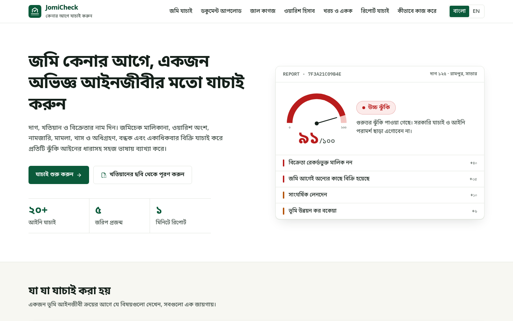
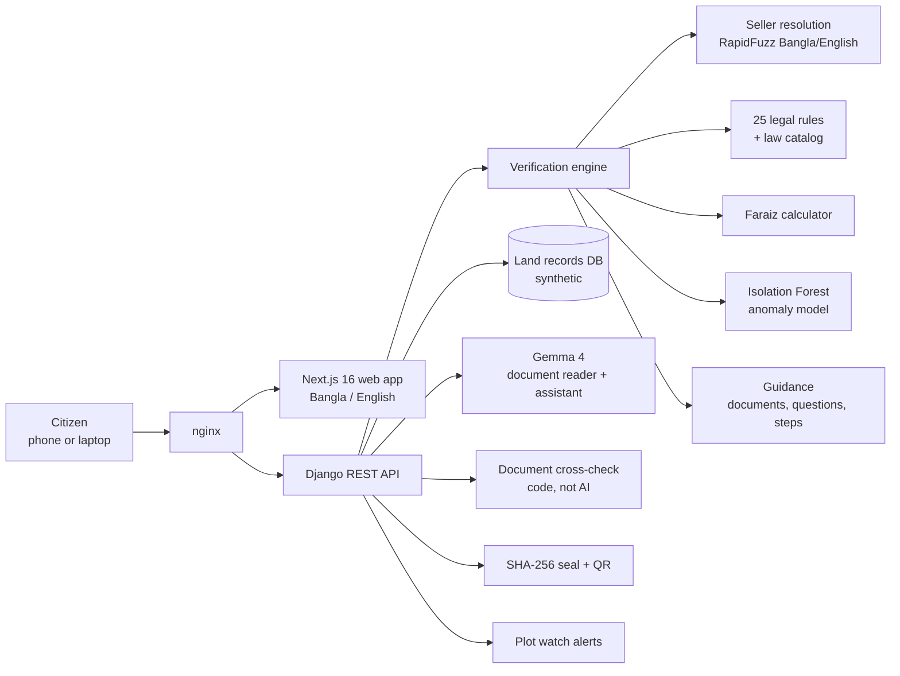
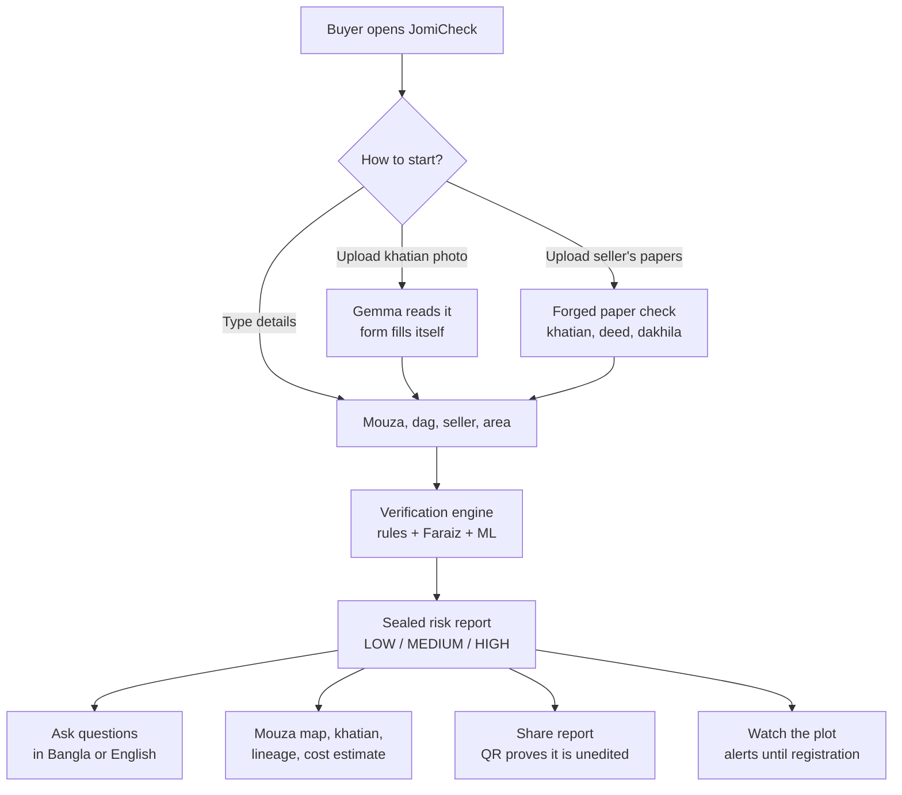

# JomiCheck — কেনার আগে যাচাই করুন

**Enter a mouza, dag number and seller's name. Get a lawyer-grade land risk report — with the law behind every finding — in under a minute.**

[Live App](http://54.179.182.123) · [Demo Video](#) · [Concept Note (PDF)](docs/JomiCheck-Concept-Note.pdf) · [How It Works](http://54.179.182.123/how-it-works)

_LandTech Innovation Hackathon 2026 · Track: Digital Land Records, Verification & Digitization · Problem **P5** Citizen Pre-Purchase Verification, with **P3** Fraud & Double-Selling Detection_

     



> JomiCheck is a decision-support and risk-screening tool. It is not official legal verification or legal advice. **All data in this prototype is synthetic.**

---

## Problem Statement

For most families in Bangladesh, buying land is the largest purchase of their lives — and one of the riskiest. The facts that decide whether a sale is safe are scattered across many offices:

- the **khatian** (record of rights) from four successive surveys — CS, SA, RS, BS
- **mutation (namjari)** cases at the AC Land office
- registered **deeds** at the sub-registry
- civil suits, injunctions, **khas** and **acquisition** lists
- bank **mortgages**, **powers of attorney**, and the **land tax (dakhila)** record

An ordinary buyer cannot read and cross-check all of this, so they rely on the seller's word and the papers the seller hands over. That gap is where fraud happens:

| Risk | What happens to the buyer |
|---|---|
| Seller is not the owner | Land recorded in someone else's name, or a deceased owner's land sold without the other heirs |
| Double selling | The same dag was already sold by registered deed, or promised by bainanama to another buyer |
| Over-selling by heirs | An heir sells more than his Faraiz share; siblings and the widow later sue |
| Forged papers | A fabricated khatian, a deed number that does not exist, a tax receipt for taxes never paid |
| Restricted land | Khas, vested, waqf or forest land; acquisition notices; injunctions; mortgages |
| Changes after checking | Between bainanama and registration the seller sells again, mortgages, or a case is filed |

The result: lost savings, years in civil court, and broken families. **Citizens need a way to screen a plot before paying any money — in their own language, without being a lawyer.**

## Solution Overview

JomiCheck is a bilingual (বাংলা / English), mobile-friendly web app that checks a plot the way an experienced land lawyer would and returns a transparent **Low / Medium / High** risk score.

| Feature | What you get |
|---|---|
| **Verify land** | District → Upazila → Mouza → Dag + seller's name → full risk report |
| **25 legal checks** | Ownership, double selling, mutation, khas/vested land, acquisition, litigation, injunction, mortgage, bainanama, power of attorney, minor's share, pre-emption (Hak-e-Shufa), survey lineage, fraud patterns |
| **Law on every finding** | Each finding cites the Act and section, explains it in plain language, and says what to do and what to ask the seller |
| **Faraiz calculator** | Each heir's share under Muslim personal law ('awl, radd, Umariyyatan) and detection of heirs selling more than their share |
| **Forged paper detection** | Upload khatian, deed and dakhila photos — Gemma reads them, code compares every field with the record |
| **Document upload** | Photograph a khatian or porcha and the form fills itself |
| **ML anomaly detection** | An Isolation Forest flags unusual transfer patterns (quick flips, broker reselling) that no single rule catches |
| **Mouza map** | The buyer's dag highlighted, neighbouring dags coloured by risk |
| **Khatian view** | Latest record of rights in the official column layout, shares in ana-gonda-kora-kranti |
| **Sealed report** | SHA-256 hash + QR code — anyone can scan to confirm the report was not edited |
| **Ask the report** | Ask questions in Bangla or English; Gemma answers using only the report's facts |
| **Plot watch** | After verifying, get alerts for any new deed, case, mortgage or buyer interest until registration |
| **Purchase cost** | Stamp duty, registration fee, local government tax, source tax and mutation fees in one place |
| **Unit converter** | Shotok, katha, bigha, acre, ojutangsho, sq ft, sq m, hectare |
| **Print / PDF** | A clean printable report for the family, bank or lawyer |

## How AI and ML Are Used

JomiCheck uses three layers, each doing only what it is trustworthy at:

| Layer | Role | Decides the risk? |
|---|---|---|
| **Rule engine** (Python) | 25 legal checks, Faraiz, scoring | **Yes** — every point comes from a named rule |
| **Gemma 4** (Google AI Studio) | Reads uploaded papers; answers questions about a report | **No** — it reads and explains, never scores |
| **Isolation Forest** (scikit-learn) | Flags statistically unusual transfers | Adds evidence or one Major finding, never declares land unsafe alone |

### Gemma 4

- **Model:** `gemma-4-26b-a4b-it` — open-weight Gemma 4 vision model (Mixture-of-Experts, ~4B active parameters), called through the official `google-genai` SDK. Any OpenAI-compatible server (e.g. local Ollama) works by changing two env vars.
- **Document reading:** the image is sent **before** the prompt and the model returns **strict JSON** (mouza, JL, khatian, dag, owners and shares, deed parties, area). Bangla numerals and units (ana-gonda, shotok, katha) are parsed by code. A khatian is read in about 10 seconds.
- **The comparison is done by code, not the AI.** `documents/crosscheck.py` checks: does this khatian number exist in this mouza; do owners and shares match; is the deed number in the sub-registry record or cancelled; are sellers, buyers and date correct; does the tax receipt's paid-up year match. A contradiction raises a **Critical** finding (Land Crime Prevention and Remedy Act 2023, s.5; Penal Code ss.467, 471).
- **Grounded assistant:** "Ask about this report" receives only the computed report, answers in Bangla or English, and the UI shows which source answered. Without an API key, a built-in bilingual legal glossary answers instead.
- **Reliability:** minimal thinking for speed, automatic retry with backoff on 503/429, and a cap on total wait time.
- **Privacy:** uploaded files are processed in memory and never stored. Because Gemma is open-weight, it can later run on government servers so citizen documents never leave the country.

### Machine learning: unusual transfer detection

Each land sale is described by five features:

| Feature | Meaning |
|---|---|
| `price_ratio` | Deed price ÷ government mouza value |
| `log_holding_days` | How long the seller held the land |
| `plot_transfers_365` | Sales of the same dag within one year |
| `area_fraction` | Share of the dag being sold |
| `seller_plots_365` | Different dags the same seller sold within one year |

Trained on 20,000 synthetic transfers with 5% planted fraud patterns (quick flip, broker, chain, under-valued deed). On a separate synthetic test set of 5,000:

| Precision | Recall | F1 | False-positive rate |
|---|---|---|---|
| 0.745 | 0.712 | 0.728 | 0.013 |

Recall by pattern: flip 0.93, broker 1.00, chain 1.00, under-valued 0.11 — under-valued deeds are handled by a separate price rule. These numbers prove the pipeline on synthetic data, not real-world accuracy.

## Technical Architecture



| Layer | Technology |
|---|---|
| Frontend | Next.js 16 (App Router), React 19, TypeScript, Tailwind CSS 4, lucide-react |
| Backend | Python 3.12+, Django 6, Django REST Framework |
| AI | Gemma 4 via Google AI Studio (`google-genai` SDK), pypdfium2 for PDFs |
| ML & matching | scikit-learn Isolation Forest, NumPy, RapidFuzz |
| Integrity | SHA-256 (hashlib), QR code (qrcode, SVG) |
| Database | SQLite in the prototype, PostgreSQL-ready |
| Hosting | AWS EC2 (Ubuntu), nginx, gunicorn, systemd — one-command `deploy/setup.sh` |

### Risk scoring

| Tier | Examples | Effect |
|---|---|---|
| **Critical** | Seller not the owner, double selling, khas/vested land, acquisition, injunction, invalid POA, uploaded paper contradicts the record | +35 to +40; result is **HIGH** regardless of score |
| **Major** | Litigation, survey break, heir over-selling, minor's land, mortgage, rapid transfers, mutation missing, prior bainanama, ML-detected unusual transfer | +20 to +30 |
| **Minor** | Conflicting deeds, pre-emption, wrong khatian number, under-priced deed, tax arrears, other buyers checking the plot | +5 to +10 |

Score is capped at 100: **LOW** 0–30 · **MEDIUM** 31–60 · **HIGH** 61–100. Because every point comes from a named rule, the result is never a black box.

## User Flow



## Screenshots

| **Verify land — 14 one-click demo cases** | **High risk: seller is not the owner, land already sold** |
|---|---|
|  |  |
| **Heir over-selling his Faraiz share** | **Only the ML model catches this broker** |
|  |  |
| **Mouza map — neighbours coloured by risk** | **Faraiz shares of every heir** |
|  |  |
| **Latest khatian in the official layout** | **Forged khatian that contradicts it (sample)** |
|  |  |
| **QR check — the report is genuine and unedited** | **Purchase cost calculator** |
|  |  |

The forged khatian names Karim Mia as sole owner of dag 118 with 16 ana. The record shows the land is still in his late father Abdul Majid's name, with four heirs. JomiCheck raises a Critical finding.

## Demo Scenarios

All 14 are on the home page and in the one-click list on `/verify`.

| # | Scenario | Dag / Mouza | Seller | Result |
|---|---|---|---|---|
| 1 | Clean property | 101 Rampur | Jamal Hossain | LOW 6 |
| 2 | Ownership mismatch + double selling | 125 Rampur | Rahim Uddin | HIGH 91 |
| 3 | Heir selling more than Faraiz share | 118 Rampur | Karim Mia | MEDIUM 55 |
| 4 | Bought by deed, mutation rejected | 132 Rampur | Shafiq Ahmed | MEDIUM 34 |
| 5 | Khas land | 140 Charabag | Bashir Ahmed | HIGH 80 |
| 6 | Government acquisition | 150 Charabag | Liton Das | HIGH 40 |
| 7 | Suit with injunction | 160 Charabag | Habib Ullah | HIGH 70 |
| 8 | Bank mortgage | 170 Charabag | Sumon Ali | MEDIUM 31 |
| 9 | Revoked power of attorney | 180 Charabag | Faruk Ahmed | HIGH 35 |
| 10 | Prior bainanama by co-owner | 190 Notunhat | Delwar Hossain | MEDIUM 36 |
| 11 | Break in survey records | 205 Notunhat | Rafiq Mondol | MEDIUM 36 |
| 12 | Rapid low-price transfers | 215 Notunhat | Imran Hossain | MEDIUM 33 |
| 13 | Widow selling minor heir's land | 225 Shantipur | Nasima Begum | HIGH 80 |
| 14 | Broker reselling quickly — only ML catches it | 235 Charabag | Selim Reza | LOW 20 + ML flag |

Critical findings force HIGH even when the score is below 61 (cases 6 and 9).

**Sample papers** on `/check-documents`: genuine khatian and deed for dag 101; a forged khatian for dag 118; and for dag 125 a deed whose number is not in the sub-registry record plus a tax receipt showing tax paid two years beyond the record. All are watermarked as synthetic and carry no government emblem.

## Impact & Validation

- **Who benefits:** first-time and rural buyers, migrant workers buying from abroad, banks and NGOs lending against land, lawyers and deed writers, and the government through fewer land disputes in court.
- **Before paying, not after:** the check runs before the bainanama money changes hands — the moment fraud is still preventable.
- **Explainable:** every point in the score comes from a named rule with its law, so a buyer, lawyer or judge can follow the reasoning.
- **Tamper-evident:** the SHA-256 seal and QR let a bank or family member confirm a shared report was not edited.
- **Tested:** 71 automated tests cover Faraiz, all 14 demo scenarios, khatian notation, costs, the ML model, AI document reading and assistant (mocked), forged-paper cross-check, plot watch, mouza map, API and tamper detection.
- **Deployed:** running on AWS EC2 behind nginx, installed by one script.
- **Path to real use:** the engine already uses the same structure as the national records (mouza, JL, dag, survey khatians, mutation case, deed). Connecting authorised e-Porcha, e-Mutation, land development tax and sub-registry APIs replaces the synthetic database without changing the rules. First target: a pilot in one upazila with the AC Land office, free for citizens.

## Run It Yourself

**Requirements:** Python 3.12+, Node.js 20+. Optional: a free Gemma API key from [Google AI Studio](https://aistudio.google.com/apikey) for document reading and the AI assistant.

### Option A — Local development

```bash
# 1. Backend
cd backend
python3 -m venv ../.venv
source ../.venv/bin/activate
pip install -r requirements.txt
cp .env.example .env                  # optional: paste your Gemma key into LLM_API_KEY
python manage.py migrate
python manage.py seed_demo            # loads the synthetic dataset
python manage.py runserver 8000

# 2. Frontend (new terminal)
cd frontend
cp .env.example .env.local            # NEXT_PUBLIC_API_URL=http://localhost:8000/api
npm install
npm run dev                           # open http://localhost:3000
```

Useful commands:

```bash
python manage.py check_llm --list                         # Gemma models your key can use
python manage.py check_llm                                # send a test question
python manage.py train_anomaly                            # retrain the ML model, writes anomaly/artifacts/metrics.json
python manage.py make_sample_docs                         # regenerate the sample khatians, deeds and dakhilas
python manage.py simulate_watch_event 101 --kind injunction   # demo a plot-watch alert (also: mortgage, bainanama; --clear)
python manage.py createsuperuser                          # records panel at /admin
```

### Option B — Deploy on an Ubuntu server (AWS EC2)

```bash
# copy the project to /opt/jomicheck, put LLM_* settings in backend/.env, then:
cd /opt/jomicheck
bash deploy/setup.sh <public-ip-or-domain>
```

The script installs Python, Node and nginx, generates a secret key, migrates and seeds the database if it is empty, trains the ML model, builds the frontend and starts everything under systemd. The frontend calls `/api` on its own origin, so the site keeps working if the server's IP changes. Open port 80 in the security group.

### Tests

```bash
cd backend && python manage.py test        # 71 tests
cd frontend && npx tsc --noEmit && npx eslint src && npm run build
```

## API Reference

| Endpoint | Method | Purpose |
|---|---|---|
| `/api/locations/` | GET | District → Upazila → Mouza tree |
| `/api/mouzas/<id>/plots/` | GET | Dag numbers in a mouza |
| `/api/mouzas/<id>/map/` | GET | Mouza map sheet with each dag's record risk |
| `/api/demo-cases/` | GET | The 14 planted demo scenarios |
| `/api/verify/` | POST | Run verification and store a sealed report |
| `/api/inheritance/` | POST | Standalone Faraiz calculator |
| `/api/documents/extract/` | POST | Read a khatian, deed or tax receipt image/PDF with Gemma (multipart `file`) |
| `/api/documents/check/` | POST | Compare read documents with the records (`mouza_id`, `documents`, optional `dag_no`) |
| `/api/watch/` | GET, POST | List watched plots with alerts / start watching (`buyer_token`, `plot_id`, `report_id`) |
| `/api/watch/<id>/?buyer_token=` | DELETE | Stop watching |
| `/api/costs/estimate/` | POST | Purchase cost estimate (`price_bdt`, `area_type`, optional `area_acre` + `mouza_rate_per_acre`) |
| `/api/reports/<id>/` | GET | Report with QR code |
| `/api/reports/<id>/verify/?h=<sha256>` | GET | Authenticity check |
| `/api/reports/<id>/ask/` | POST | Ask the report assistant |

## Project Structure

```
backend/
  land/            land record models, synthetic data generator, mouza map, location & demo APIs
  verification/    engine, rule catalog (law + bilingual text), Faraiz, name matching, guidance, assistant
  reports/         sealed reports, SHA-256 + QR integrity, report APIs
  documents/       Gemma document reading (extract.py), record cross-check (crosscheck.py)
  anomaly/         ML features, synthetic training data, Isolation Forest train/score
  watch/           plot watch snapshots and alerts
  costs/           purchase-cost rates and calculator
frontend/src/
  app/             /, /verify, /upload, /check-documents, /report/[id], /watch,
                   /verify-report, /inheritance, /costs, /how-it-works
  components/      risk gauge, findings, timeline, lineage, Faraiz table, khatian sheet,
                   mouza map, document check, watch, assistant, integrity
  lib/             API client, Bangla/English i18n, unit conversion
deploy/            nginx, systemd units, setup.sh for Ubuntu
docs/              concept note (HTML + PDF), screenshots
```

## Data, Ethics & Limitations

- **All data is synthetic.** Every person, plot, khatian, deed, case, mortgage and NID is fictional (NIDs are dummy numbers like `0000000001`). Only district and upazila names are real. No government portal is accessed, scraped or queried.
- **Decision support, not legal advice.** Every report says so and directs the buyer to the AC Land office, sub-registry and a lawyer.
- **The AI never decides the risk.** Rules do, and every rule is visible. Uploaded documents are processed in memory and never stored.
- **ML accuracy is synthetic.** The model must be retrained on real, authorised transaction data.
- **Mouza map outlines are generated**, not surveyed; real deployment needs digital cadastral maps from DLRS.
- **Inheritance** is automatic for Muslim law only; for other owners JomiCheck asks for a lawyer's review instead of guessing.
- Purchase-cost rates in `backend/costs/rates.py` were compiled from public information in October 2026 and are indicative.

## Future Work

- Connect authorised **e-Porcha, e-Mutation, land tax and sub-registry** APIs in place of the synthetic database
- **Hindu (Dayabhaga) and Christian** inheritance rules; more documents (DCR, mutation order, heirship certificate)
- **SMS alerts** for plot watch, HTTPS with a domain, a Bangla report format tuned for banks
- **Self-hosted Gemma** for privacy, and an offline reader when the cloud model is unavailable
- Real **cadastral maps** and retraining the anomaly model on real transfers
- Legal review of every rule with a practising land lawyer; user testing with buyers and deed writers

## Legal References

The rule catalog (`backend/verification/catalog.py`) cites the Registration Act 1908 (s.17A, s.52A), Transfer of Property Act 1882 (s.53C, s.58), State Acquisition and Tenancy Act 1950 (s.96, s.145A), Land Crime Prevention and Remedy Act 2023, Land Development Tax Act 2023, Power of Attorney Act 2012, Acquisition and Requisition of Immovable Property Act 2017, Vested Property Return Act 2001, Guardians and Wards Act 1890, Code of Civil Procedure Order XXXIX, Penal Code 1860 (ss.467, 471) and Muslim personal law (Faraiz).

## AI Tools Used

- **Cursor (AI coding assistant)** helped scaffold the Django and Next.js projects, draft code for the engine, data generator, API and UI, and write tests and documentation. All code was reviewed, run and tested by the team.
- **Gemma 4 (Google AI Studio)** is part of the product: it reads uploaded documents and answers questions about a report, using synthetic data only. It never sets the risk score.

## Open-Source Libraries

Django (BSD-3), Django REST Framework (BSD-3), django-cors-headers (MIT), qrcode (BSD), RapidFuzz (MIT), Pillow (MIT-CMU), google-genai (Apache-2.0), pypdfium2 (Apache-2.0/BSD-3), scikit-learn (BSD-3), NumPy (BSD-3), joblib (BSD-3), Next.js (MIT), React (MIT), Tailwind CSS (MIT), lucide-react (ISC), IBM Plex and Noto Sans Bengali fonts (SIL OFL 1.1).

## Team

| Role | Name |
|---|---|
| Team Leader | _[Name]_ |
| Member | _[Name]_ |
| Faculty Mentor | _[Name], [University]_ |

---

Developed by **Team Semicolons** · Built for land buyers of Bangladesh · **LandTech Innovation Hackathon 2026**
